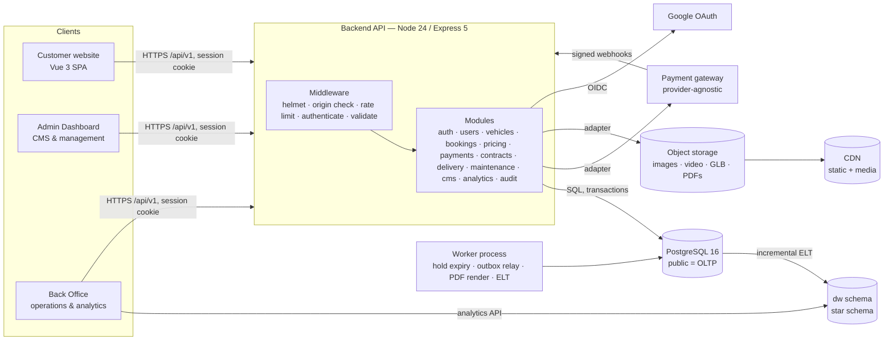
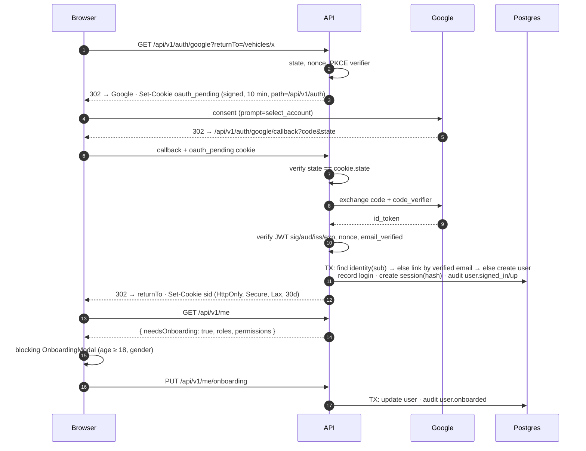
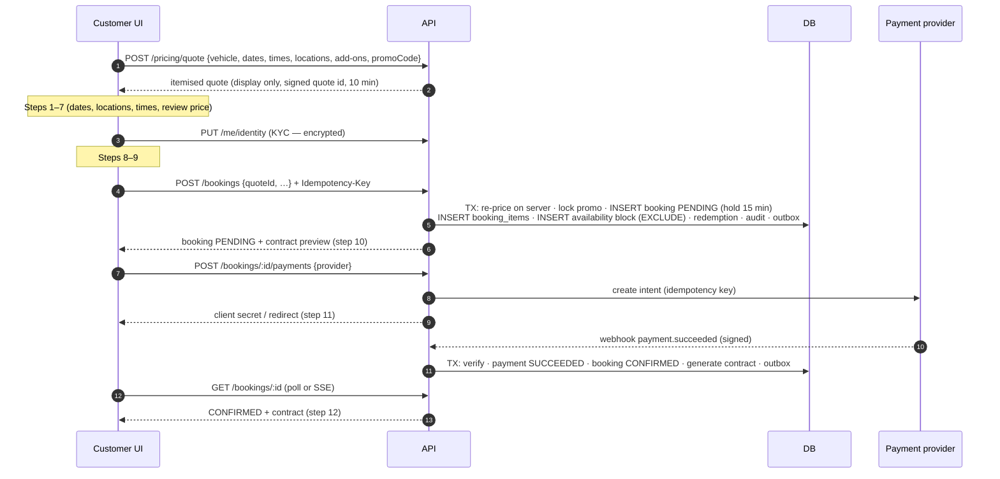

# Aurelia Drive — Technical Architecture

> Premium car-rental platform: customer website, admin dashboard + back office, and a database / analytics layer.
> This document is the architecture of record. Companion docs: [DATABASE.md](DATABASE.md) (schema, ERD, KPI formulas) and [API.md](API.md) (endpoints).

---

## 0. Status

| Phase | Scope | State |
|---|---|---|
| **1** | Architecture, full database schema (11 migrations), seed, Google OAuth, sessions, RBAC, onboarding, audit log | **Done**, with 26 integration tests passing |
| 2 | Vehicle / category / location management APIs, media upload | Next |
| 3 | Customer website: CMS-driven hero, category slider, listing, detail (3D) | **Mostly done**: public catalogue API, homepage, fleet listing, vehicle detail + availability calendar (see [DESIGN.md](DESIGN.md)). 3D viewer pending |
| 4 | Availability API, pricing engine, booking engine | |
| 5 | Payment abstraction + first provider + webhooks | |
| 6 | Contract generation (template → HTML → PDF) | |
| 7 | Customer dashboard, booking history, delivery tracking | |
| 8 | Admin dashboard, CMS editor, vehicle & booking management | |
| 9 | Back office analytics, warehouse ELT, reports | |
| 10 | Maintenance, staff operations, audit UI | |
| 11 | Performance, security hardening, load tests, production deploy | |

The database for phases 2–10 is **already in place**. Each later phase adds API modules and UI on top of tables, constraints and triggers that are already tested.

---

## 1. Requirements analysis

### 1.1 Missing relationships and entities the spec implied but didn't list

| Gap | Resolution |
|---|---|
| The spec lists `staff` but roles are on `users`. How do they relate? | `staff` is a **profile** of a `users` row (`staff.user_id UNIQUE`). There is one identity for everyone, and roles live in `user_roles`. Operational tables (deliveries, maintenance, mileage) reference `staff.id`. |
| Bookings and maintenance both block a car, but they're separate tables, so one constraint can't span both | A single **availability ledger** (`vehicle_availability_blocks`) holds every reason a car is unavailable, and one `EXCLUDE` constraint covers all of them (see §5). |
| Nothing stores the cleaning/inspection gap between rentals | `vehicles.turnaround_minutes` is added to each booking block. |
| Prices change over time, so analytics and dynamic pricing need history | `vehicle_price_history` is filled by a trigger and records the actor. |
| The pricing breakdown needs to be reproducible later | Itemised `booking_items` (append-only) plus `bookings.pricing_snapshot`. |
| Promotion usage limits | `promotion_redemptions`, released automatically when a booking is cancelled or expires. |
| Payment webhooks need idempotency | `payment_webhook_events` with `UNIQUE(provider, provider_event_id)`. |
| Double-submitting POSTs (booking, payment) | `idempotency_keys`. |
| Add-on services and insurance had no catalogue | `add_on_services`. |
| Business configuration (tax, deposit policy, hold window) was mixed with CMS content | Kept separate: `system_settings` (finance/ops) vs `website_content` (marketing). |
| Feature lists need to be filterable | `features` catalogue + `vehicle_features` join, instead of free-text arrays. |
| A pending, unpaid booking holds a car forever | `bookings.hold_expires_at` + an expiry job → `EXPIRED`. Expiry releases the block. |
| Real-time updates, notifications and analytics feeds | Transactional **outbox** (`outbox_events`). |
| A contract must survive template edits | Versioned, immutable published templates. Each contract freezes its `data_snapshot` and stores a hash. |
| Booking status (lifecycle) vs delivery status (logistics) were blended | Separate state machines: `bookings.status` and `delivery_assignments.status`. The customer timeline merges both. |

### 1.2 Potential database problems, and how they're handled

| Problem | Mitigation |
|---|---|
| Floating-point money | All money is `BIGINT` minor units + `CHAR(3)` currency. Percentages are basis points. |
| Status as a PG `ENUM` is painful to evolve | `TEXT + CHECK`. The booking state machine is a table (`booking_status_transitions`) enforced by trigger. |
| Soft delete breaks `UNIQUE` (you can't recreate slug `x` after archiving `x`) | Partial unique indexes: `UNIQUE (slug) WHERE deleted_at IS NULL`. |
| Hard deletes of history | A `prevent_hard_delete` trigger on business tables, and a `prevent_mutation` trigger on append-only logs (audit, history, ledger, tracking). |
| Storing "age" goes stale | Store `age_reported` + `age_reported_at`. The authoritative DOB comes from the KYC step. |
| UUID v4 index locality | Acceptable at this scale. Migrate to UUIDv7 (PG18 native, or app-generated) if insert-heavy tables grow past ~10⁸ rows. |
| Event tables (analytics, GPS) grow unbounded | BRIN indexes on time now. Monthly range partitioning when they reach about 50M rows, and roll-ups go to `dw.*`. |
| Timezones | Every instant is `timestamptz`. Each location has an IANA `timezone`, and the pricing engine counts rental days in the pickup location's zone. |
| OLTP queries for analytics slow down checkout | A separate `dw` schema (star schema) fed by incremental ELT, with a read replica in production. |

### 1.3 Security risks

| Risk | Control |
|---|---|
| Session theft / DB leak | Opaque 256-bit token in an `HttpOnly; Secure; SameSite=Lax` cookie. Only the **SHA-256** is stored. Revocable server-side. Suspending a user kills all their sessions immediately. |
| OAuth attacks (CSRF, code injection, replay) | `state` (signed, short-lived cookie) + **PKCE S256** + `nonce` checked in the ID token. The ID token signature, `aud`, `iss` and `exp` are verified by `google-auth-library`, and `email_verified` is required. |
| Open redirect after login | `returnTo` must be a same-site relative path. `//evil` is rejected (tested). |
| CSRF on the JSON API | SameSite=Lax + an **Origin allow-list** on every unsafe method. Webhooks are exempt because they authenticate by signature. |
| Privilege escalation | Server-side `requirePermission()` on every admin route. Frontend guards are UX only. Roles are granted by `roles:manage` only, and every grant is audited. |
| Identity documents (PII) | **AES-256-GCM** application-level encryption with a versioned key, plus `last4` for display and HMAC for duplicate detection. Private bucket with signed URLs. Visible only to `users:read_sensitive`. Scrubbed from audit JSON. |
| Payment tampering | Prices are computed on the server only. A booking becomes `CONFIRMED` only after a **backend-verified** payment (webhook signature + provider API re-fetch). No card data ever touches our servers (provider-hosted fields). |
| Secrets in the frontend | Secrets exist only in backend env (validated by zod at boot). The frontend sees only `GET /auth/providers` booleans. |
| Brute force / scraping | `express-rate-limit`: global 300/min, auth 30/15 min, analytics ingest 120/min. Move to a Redis store when running more than one instance. |
| Injection | Parameterised SQL only. zod whitelists every request body, query and param. |
| Header hardening | `helmet` (CSP, HSTS, frame-ancestors, nosniff, referrer-policy). |
| Audit tampering | `audit_logs` rejects UPDATE/DELETE/TRUNCATE via trigger. In production the app DB role gets INSERT only (see §10). |
| Log leakage | pino redaction of cookies and auth headers. Request logs contain method, URL and status only. |

### 1.4 Booking concurrency problems

1. **Two customers book the same car at the same moment.** A read-then-write check races. Fix: a PostgreSQL `EXCLUDE USING gist (vehicle_id WITH =, during WITH &&) WHERE (released_at IS NULL)`. The database itself refuses the second overlapping row, whichever API instance sends it. Covered by a test that fires 8 concurrent attempts and expects exactly one to succeed.
2. **Booking vs maintenance race.** The same constraint applies because maintenance writes into the same ledger.
3. **Payment completes after the hold expired and another customer took the car.** The payment webhook handler re-checks in a transaction. If the block was released, it auto-refunds and notifies the customer. If it's still held, it confirms.
4. **Duplicate webhook delivery.** The inbox has a unique `(provider, event_id)`, so the handler is idempotent.
5. **Double-click on "Pay".** `idempotency_keys` + `payments UNIQUE(provider, idempotency_key)`.
6. **Promotion usage limit oversubscribed.** `SELECT … FOR UPDATE` on the promotion row inside the booking transaction, then count live redemptions.

### 1.5 Scalability concerns

- **Stateless API.** Sessions live in Postgres, so any instance can serve any request. Next steps: rate-limit and cache in Redis.
- **Read-heavy catalogue.** Vehicle listing and CMS content are cacheable (CDN `s-maxage` + ETag). Invalidate on admin write via the outbox.
- **Media.** Object storage + CDN, with responsive variants (`media.variants`). 3D models are Draco-compressed GLB, lazy-loaded behind a poster image.
- **Analytics** never reads OLTP during peak. Events are batched to `analytics_events`, aggregated into `dw`, and the warehouse can be lifted to BigQuery/ClickHouse later.
- **Background work** (hold expiry, outbox relay, contract PDF rendering, ELT) runs as a separate worker process using `FOR UPDATE SKIP LOCKED` job claiming. No broker is needed until scale requires one.
- **Real-time delivery tracking.** Phase 7 uses SSE fed by the outbox (`delivery.status_changed`). The same outbox can feed WebSockets or a message bus later.

---

## 2. System architecture



### Layering (enforced by convention, reviewed in PRs)

```
routes (HTTP: parse, validate, guard, shape response)
  → service (business rules, transactions, audit, no req/res)
     → repository (SQL only)
        → PostgreSQL (constraints, triggers = last line of defence)
adapters: identity provider · payment gateway · storage · pdf renderer  (injected, swappable)
```

Rules:
- No business logic in Vue components. Components call stores/services, which call `api()`.
- No SQL outside repositories. No `req`/`res` inside services.
- Every state change that matters is in one transaction with its `audit_logs` row and its `outbox_events` row.
- External providers sit behind an interface and are injected in `createApp()`. Tests use fakes.

---

## 3. Folder structure

```
car rental2/
├── docs/                      ARCHITECTURE.md · DATABASE.md · API.md
├── docker-compose.yml         postgres + api + web for local/prod-like runs
├── backend/
│   ├── src/
│   │   ├── server.js          process bootstrap, graceful shutdown
│   │   ├── app.js             express app factory (DI for providers)
│   │   ├── config/env.js      zod-validated configuration
│   │   ├── db/
│   │   │   ├── pool.js        pg pool + withTransaction(actorId, isolation)
│   │   │   ├── migrate.js     forward-only, checksummed, advisory-locked
│   │   │   ├── seed.js        idempotent seed (RBAC, settings, CMS, demo fleet)
│   │   │   └── migrations/    0001…0011 *.sql
│   │   ├── middleware/        auth · security (origin, rate limit) · validate · errors
│   │   ├── shared/            errors · crypto (AES-GCM, hashing) · logger
│   │   ├── modules/
│   │   │   ├── auth/          google.provider · auth.service · auth.routes · session.repository
│   │   │   ├── users/         me.routes · users.service · users.repository · users.schemas
│   │   │   ├── rbac/          permissions.js (single source of truth)
│   │   │   ├── audit/         audit.service · audit.routes
│   │   │   ├── vehicles/      (P2)  categories/ locations/ media/
│   │   │   ├── availability/  (P4)  pricing/ (P4) bookings/ (P4) promotions/ (P4)
│   │   │   ├── payments/      (P5)  providers/{mock,stripe,omise}.adapter.js
│   │   │   ├── contracts/     (P6)  renderer/
│   │   │   ├── delivery/      (P7)  notifications/ (P7)
│   │   │   ├── cms/           (P8)
│   │   │   ├── analytics/     (P9)  events ingest · KPI queries · ELT jobs
│   │   │   └── maintenance/   (P10) staff/
│   │   └── worker.js          (P4+) background jobs
│   └── tests/                 node:test + supertest against car_rental_test
└── frontend/
    └── src/
        ├── main.js · App.vue · router/
        ├── api/http.js        fetch wrapper (cookie auth, error shape)
        ├── stores/            pinia: auth, (booking, catalogue, cms…)
        ├── styles/            tokens.css (design system) · base.css
        ├── components/
        │   ├── ui/            buttons, inputs, cards, modal, table, chart wrappers
        │   ├── layout/        AppHeader, AppFooter, AdminShell
        │   ├── auth/          GoogleButton, OnboardingModal
        │   ├── vehicles/      VehicleCard, SpecIcons, Viewer3D (lazy), Gallery
        │   ├── booking/       Stepper, AvailabilityCalendar, PriceBreakdown
        │   └── charts/        KPI, Line, Bar, Heatmap, Funnel (lazy chunk)
        └── views/
            ├── (customer)     Home, Vehicles, VehicleDetail, Booking, Account/*
            ├── admin/         CMS, Vehicles, Bookings, Customers, Promotions, Contracts
            └── backoffice/    Revenue, Fleet, Customers, Promotions, Ops, Maintenance, Audit
```

Admin and Back Office are route groups inside the same SPA, **lazy-loaded as separate chunks**. Customers never download admin code. They can be split into a separate app later without API changes.

---

## 4. Authentication and authorization

### 4.1 Google sign-in flow



- Booking routes use `requireOnboarded`, so the onboarding requirement is enforced **on the server**, not only by the modal.
- Logout revokes the session row. Suspended users fail session lookup immediately.
- Bootstrap: emails in `BOOTSTRAP_SUPER_ADMINS` get `super_admin` on sign-in. Roles are managed in the admin UI after that (Phase 8).

### 4.2 Permission matrix

Source of truth: [`backend/src/modules/rbac/permissions.js`](../backend/src/modules/rbac/permissions.js). The seed syncs it to the DB.

| Permission | Super Admin | Admin | Fleet Mgr | Operations | Finance | Delivery | Maintenance |
|---|:-:|:-:|:-:|:-:|:-:|:-:|:-:|
| users:read | ✓ | ✓ | | ✓ | ✓ | | |
| users:read_sensitive (ID docs) | ✓ | ✓ | | ✓ | | | |
| users:write | ✓ | ✓ | | | | | |
| roles:manage | ✓ | | | | | | |
| staff:read / staff:write | ✓ / ✓ | ✓ / ✓ | ✓ / – | ✓ / – | | | |
| vehicles:read / write / archive | ✓ | ✓ | ✓ | read | read | read | read |
| vehicles:price | ✓ | ✓ | ✓ | | | | |
| categories:write · locations:write | ✓ | ✓ | ✓ | | | | |
| bookings:read | ✓ | ✓ | ✓ | ✓ | ✓ | ✓ | |
| bookings:write · bookings:cancel | ✓ | ✓ | | ✓ | | | |
| payments:read | ✓ | ✓ | | ✓ | ✓ | | |
| payments:refund | ✓ | ✓ | | | ✓ | | |
| contracts:read | ✓ | ✓ | | ✓ | ✓ | | |
| contracts:write (templates, void) | ✓ | ✓ | | ✓ | | | |
| promotions:read / write | ✓ | ✓ | read | read | read | | |
| cms:write | ✓ | ✓ | | | | | |
| deliveries:read | ✓ | ✓ | ✓ | ✓ | | ✓ | |
| deliveries:assign | ✓ | ✓ | | ✓ | | | |
| deliveries:update (own) | ✓ | ✓ | | | | ✓ | |
| maintenance:read / write | ✓ | ✓ | ✓ | read | | | ✓ |
| analytics:read | ✓ | ✓ | ✓ | | ✓ | | |
| analytics:finance (revenue, ROI) | ✓ | ✓ | | | ✓ | | |
| audit:read | ✓ | ✓ | | | | | |
| settings:write (tax, policy) | ✓ | | | | | | |

**Row-level rules** live in services, on top of permissions:
- Customers see only their own bookings, payments, contracts and notifications.
- Delivery staff can update only assignments where `staff_id` is their own.
- PII fields are masked unless the caller holds `users:read_sensitive`, and every unmask is audited (`customer.identity_viewed`).

---

## 5. Vehicle availability logic

**Single source of truth:** `vehicle_availability_blocks(vehicle_id, block_type, during tstzrange, released_at)` with:

```sql
EXCLUDE USING gist (vehicle_id WITH =, during WITH &&) WHERE (released_at IS NULL)
```

| Writer | Block |
|---|---|
| Booking created (PENDING) | `BOOKING [pickup_at, return_at + turnaround)` |
| Booking → CANCELLED / EXPIRED | trigger sets `released_at` |
| Booking → COMPLETED early | trigger shrinks the range to `actual_return + turnaround` |
| Maintenance SCHEDULED / IN_PROGRESS | trigger inserts or updates a `MAINTENANCE [scheduled_start, scheduled_end)` block |
| Maintenance COMPLETED / CANCELLED | trigger releases it |
| Admin hold | `UNAVAILABLE` |

**Calendar API** (`GET /vehicles/:id/availability?from&to`) returns day cells coloured from live blocks:
GREEN (no block) · RED (BOOKING) · ORANGE (MAINTENANCE) · GRAY (UNAVAILABLE, vehicle not ACTIVE, outside the booking window, or the location is closed). Customers never see booking owners.

**Checkout re-validation:** the frontend calendar is advisory. The booking transaction inserts the block, and the `EXCLUDE` constraint is the final check. A `23P01` error becomes `409 VEHICLE_UNAVAILABLE`, and the UI refreshes the calendar.

---

## 6. Booking and pricing

### 6.1 Booking flow (12 steps → 4 server calls)



### 6.2 Pricing engine (pure function, versioned)

```
input:  vehicle rates, pickup/return instants, pickup/return locations, add-ons, promotion, settings
days      = max(min_rental_days, floor(duration / 24h))
extraMins = duration − days×24h
if extraMins ≤ grace (59 min)                  → 0 extra
elif hourly_rate and extra hours × hourly < daily → EXTRA_HOURS line (ceil hours)
else                                           → days += 1
RENTAL        = days × daily_rate
ADD_ON        = Σ per_day × days × qty | per_booking × qty
FEES          = pickup_fee(loc) + return_fee(loc) + one_way_fee(if loc differ) + delivery_fee(if DELIVERY)
subtotal      = RENTAL + EXTRA_HOURS + ADD_ON + FEES
DISCOUNT      = best eligible promotion (see §7), applied to RENTAL (+EXTRA_HOURS) only, ≤ max_discount
taxable_base  = Σ taxable lines − DISCOUNT
TAX           = round_half_even(taxable_base × tax_rate_bps / 10000)
total         = subtotal − DISCOUNT + TAX          (DB CHECK enforces this identity)
deposit       = vehicle.deposit_minor               (authorised separately, refundable)
```

The engine's output is persisted as `booking_items` + `pricing_snapshot` (engine version, rates, tax rate, promotion evaluated), so any invoice can be reproduced exactly. The frontend calls the same `/pricing/quote` for display. It never computes prices itself.

---

## 7. Promotion logic

A promotion is **eligible** for a quote when all of these hold:
1. `status = 'ACTIVE'` and `deleted_at IS NULL`.
2. `starts_at ≤ now() < ends_at` at **booking time** (business rule 11: expired promotions never auto-apply).
3. Target match: `applies_to_all`, **or** the vehicle is in `promotion_vehicles`, **or** the vehicle's category is in `promotion_categories`.
4. `min_rental_days ≤ days ≤ max_rental_days` (when set).
5. `code IS NULL` (auto-apply), or the customer entered the matching code.
6. Usage: live redemptions < `usage_limit`, and the user's live redemptions < `per_user_limit` (checked under `FOR UPDATE`).

Selection: the **single best** discount for the customer (highest amount, ties broken by `priority`). Promotions don't stack.
Display: `original_daily`, `promo_daily`, `% off`, `ends_at` → "Promotion ends in 2 days" is computed client-side from `ends_at`.
Funnel tracking (`promotion_events`): IMPRESSION → CLICK → VEHICLE_VIEW → BOOKING_STARTED → APPLIED → BOOKING_COMPLETED.

---

## 8. Payment architecture

```ts
interface PaymentProvider {
  name: string
  createIntent({ paymentId, amountMinor, currency, customer, idempotencyKey, returnUrl }): Promise<{ providerPaymentId, clientSecret?, redirectUrl?, status }>
  retrieve(providerPaymentId): Promise<{ status, amountMinor, methodType, last4 }>
  refund({ providerPaymentId, amountMinor, idempotencyKey }): Promise<{ providerRefundId, status }>
  cancel(providerPaymentId): Promise<void>
  verifyWebhook(rawBody: Buffer, headers): { eventId, type, providerPaymentId, data }   // throws on bad signature
}
```

- Adapters live under `modules/payments/providers/` (`mock` for dev and tests first, then Stripe/Omise/2C2P). Selection is by config, and the provider name is stored per payment, so providers can change without a migration.
- Statuses: `INITIATED → REQUIRES_ACTION → AUTHORIZED → SUCCEEDED | FAILED | CANCELLED → PARTIALLY_REFUNDED | REFUNDED`.
- **Confirmation rule:** only the webhook handler (or a server-side `retrieve()` reconciliation job) can move a booking to `CONFIRMED`. The browser's "success" redirect only triggers a poll.
- Webhook pipeline: raw body → `verifyWebhook` → insert `payment_webhook_events` (dedupe) → process in TX → mark processed. Failures are retried by the worker with backoff.
- Refunds (full or partial) need `payments:refund`, write `refunds` + `payment_transactions(REFUND)`, and are audited. A refund after cancellation moves the booking `CANCELLED → REFUNDED`.

---

## 9. Contract generation

```
booking CONFIRMED (same TX as payment success)
 → outbox: contract.requested
 → worker: load published template for (code, locale, country)
          build data_snapshot (customer, masked IDs, vehicle, booking, pricing, payment, terms)
          validate snapshot against template.variables_schema
          render Handlebars → HTML (HTML-escaped by default) → sha256
          INSERT contracts (ISSUED, template_id, snapshot, hash)
          render PDF (headless Chromium) → private bucket → media → contracts.document_media_id
          audit contract.generated · notify customer
customer signs (click-wrap now, e-sign provider later) → SIGNED (ip, ua, time)
booking modified → new contract supersedes old (supersedes_contract_id)
```

- **Template changes need no code change.** Admins publish version N+1, and old contracts keep pointing at version N. A DB trigger makes published templates immutable.
- One live contract per booking is enforced by a partial unique index.
- Downloads go through `GET /contracts/:id/document`, which checks ownership or permission, streams from a short-lived signed URL, and logs a `CONTRACT_DOWNLOAD` event.

---

## 10. Delivery, maintenance, staff operations

- **Delivery timeline** shown to the customer is merged from:
  - Booking: `CONFIRMED` → `PREPARING` (vehicle prep) → `READY`
  - Assignment: `ASSIGNED` (driver assigned) → `VEHICLE_PICKED_UP` → `EN_ROUTE` → `ARRIVING` → `DELIVERED`
  - Booking: → `ACTIVE`

  ETA, driver first name and photo are shown, and the map appears when `delivery_tracking` has `LOCATION` pings. Updates are pushed over SSE from the outbox.
- **Maintenance:** plans (`vehicle_maintenance`: interval km/days → next due) and records (`maintenance_records` + `maintenance_parts`). Scheduling a record blocks the calendar, and `IN_PROGRESS` sets the vehicle to `MAINTENANCE`. Both are DB triggers, already tested. A daily job raises alerts when `next_due_at` or `next_due_km` is within a threshold.
- **Mileage:** every reading is in `vehicle_mileage`, and odometers may only go up (trigger, tested). Pickup and return readings fill `bookings.odometer_start_km` / `odometer_end_km` → `distance_km` (generated column).
- **Staff log:** `staff_activity_logs` records physical actions (inspected, marked ready, delivered, received…), while `audit_logs` records data changes. Together they answer "who handled this car?".

---

## 11. Analytics architecture

```
Browser ──batched beacons──▶ POST /events (zod per event, no PII, rate-limited) ──▶ analytics_events
OLTP tables + outbox ─────────────────────────────────────────────────────────────┐
                                                                                  ▼
                       worker: incremental ELT (watermarks in dw.etl_runs, every 15 min)
                                                                                  ▼
   dw.dim_date · dim_customer (SCD2) · dim_vehicle (SCD2) · dim_category · dim_location · dim_promotion · dim_staff
   dw.fact_bookings (accumulating snapshot) · fact_payments · fact_vehicle_usage (vehicle × day)
   dw.fact_maintenance · fact_promotion_events (daily) · fact_website_events (daily)
                                                                                  ▼
                 Back office analytics API (cached) ─▶ dashboards · CSV export · future BI / ML
```

- Every dashboard chart is tied to a **business question** and a KPI defined in [DATABASE.md §6](DATABASE.md#6-kpi-definitions).
- `fact_vehicle_usage` at vehicle×day grain is what makes utilisation, revenue per vehicle, and demand forecasting cheap.
- ML readiness: lead time, SCD2 price history, attribution, age bands, promotion exposure and maintenance downtime are all captured now. Forecasting, dynamic pricing, churn and predictive maintenance can train on `dw` without schema changes.

### Back office dashboard map

| Dashboard | Business question | Visual |
|---|---|---|
| KPI strip | How are we doing right now? | KPI cards with sparkline + Δ vs previous period |
| Revenue | What is our daily/weekly/monthly revenue, and is it growing? | Line (period selector) |
| Revenue by category / location / promotion | Where does revenue come from? | Horizontal bar, sorted |
| Fleet utilisation | Which cars earn their keep, and which sit idle? | Heatmap (vehicle × week), ranking table |
| Low-ROI vehicles | What should we sell or reprice? | Ranking table: revenue/day vs cost |
| Promotion funnel | Which promotions convert and which only get clicks? | Funnel + table (CTR, CVR, revenue) |
| Customers | Are customers coming back? | Cohort retention heatmap; segment bar |
| Rental duration / AOV | How long and how much per booking? | Histogram; line |
| Operations | What's pending today? | Tables: deliveries, returns, maintenance alerts |
| Website | Where do visitors drop off? | Funnel PAGE_VIEW → VEHICLE_VIEW → BOOKING_STARTED → COMPLETED |

---

## 12. Media management

`media` holds metadata only: type, storage key, CDN URL, MIME, size, dimensions, duration, checksum, `is_private`, responsive `variants`, uploader. Business tables reference `media.id` through typed joins (`vehicle_images`, `vehicle_3d_assets`, banners, contracts).

Upload flow (Phase 2): `POST /admin/media/uploads` → presigned PUT URL (size and MIME allow-list) → client uploads directly to storage → `POST /admin/media/:id/complete` → worker generates variants (AVIF/WebP widths; video poster; GLB validation + Draco check).

---

## 13. Frontend design system and motion

- **Tokens** in [`frontend/src/styles/tokens.css`](../frontend/src/styles/tokens.css): graphite neutrals with one champagne accent, Unbounded (display) + Inter (body), tight radii (4/8/14px), 4px spacing scale, motion durations and easings. CMS `site.theme` overrides tokens at runtime.
- **Motion:** CSS transitions for micro-interactions. IntersectionObserver-driven reveals. GSAP ScrollTrigger only on the homepage chunk. The 3D viewer (`<model-viewer>` / three.js) is lazy-loaded on interaction or visibility, behind a poster. `prefers-reduced-motion` zeroes all durations globally and swaps the hero video for its poster.
- **Performance budget:** initial JS < 120 KB gz on the homepage (currently 43 KB gz), LCP < 2.5 s on 4G, hero video `preload="none"` with a poster first. Admin and charts are separate chunks.

---

## 14. Deployment (target)

- Containers: `api`, `worker`, `web` (static build behind a CDN), plus managed Postgres (PITR backups, read replica for `dw` queries) and object storage.
- Same-origin routing in production (`/api` → api) keeps cookies first-party, so no CORS is needed.
- DB roles: `app_rw` (DML, no DDL, INSERT-only on `audit_logs`), `migrator` (DDL), `analytics_ro` (SELECT on `dw`).
- Secrets come from the platform secret manager. `PII_ENCRYPTION_KEY` lives in KMS, and key rotation uses the `encryption_key_version` byte.
- CI: lint → unit → integration tests on an ephemeral Postgres → build → migrate (advisory-locked) → deploy.
