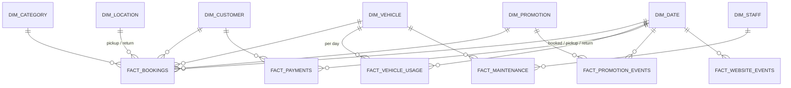
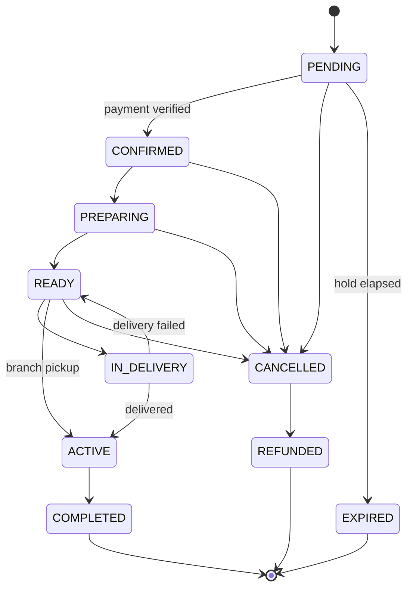

# Database design

PostgreSQL 16. The source of truth is the SQL in [`backend/src/db/migrations/`](../backend/src/db/migrations/), where each file is commented. This document explains the design. It doesn't repeat every column.

| Migration | Contents |
|---|---|
| 0001_foundation | extensions (pgcrypto, citext, btree_gist), shared triggers: `set_updated_at`, `prevent_hard_delete`, `prevent_mutation`, `current_actor_id()` |
| 0002_identity_access | users, user_identities, sessions, roles, permissions, role_permissions, user_roles, staff, idempotency_keys |
| 0003_media_cms | media, website_content, system_settings, homepage_sections, homepage_banners |
| 0004_fleet | locations, vehicle_categories, vehicles, vehicle_price_history, vehicle_images, vehicle_3d_assets, features, vehicle_features, vehicle_mileage, **vehicle_availability_blocks** |
| 0005_promotions | promotions, promotion_vehicles, promotion_categories, promotion_events |
| 0006_bookings | customer_identities, add_on_services, bookings, booking_items, promotion_redemptions, booking_status_transitions, booking_status_history |
| 0007_payments | payments, payment_transactions, refunds, payment_webhook_events |
| 0008_contracts | contract_templates, contracts |
| 0009_operations | delivery_assignments, delivery_tracking, vehicle_maintenance, maintenance_records, maintenance_parts, staff_activity_logs, notifications, favorites, reviews |
| 0010_audit_events | audit_logs, analytics_events, outbox_events |
| 0011_warehouse | `dw` schema: dim_date (2020–2040), dim_customer, dim_vehicle, dim_category, dim_location, dim_promotion, dim_staff, fact_bookings, fact_payments, fact_vehicle_usage, fact_maintenance, fact_promotion_events, fact_website_events, etl_runs |

Commands (from `backend/`): `npm run db:migrate`, `npm run db:status`, `npm run db:seed`, `npm test`.

---

## 1. Conventions

| Topic | Rule |
|---|---|
| Primary keys | `uuid DEFAULT gen_random_uuid()` for entities. High-volume append-only logs use `bigint GENERATED ALWAYS AS IDENTITY`. |
| Money | `bigint` minor units (`*_minor`) + `char(3)` currency. Percentages are basis points (2000 = 20%). |
| Time | Always `timestamptz`. Locations carry an IANA `timezone` for day counting. |
| Enumerations | `text` + `CHECK (… IN (…))`. Evolvable with a one-line migration. |
| Soft delete | `deleted_at`, `deleted_by` (+ `status`). Uniqueness via partial indexes `WHERE deleted_at IS NULL`. Hard DELETE is blocked by trigger on vehicles, users, bookings, payments, contracts, locations, categories, promotions, maintenance_records, staff, availability blocks, contract templates. |
| Append-only | audit_logs, booking_status_history, booking_items, payment_transactions, vehicle_price_history, vehicle_mileage, delivery_tracking, staff_activity_logs reject UPDATE/DELETE by trigger. |
| Actor attribution | The API runs `set_config('app.actor_id', <user>, true)` per transaction. Triggers read `current_actor_id()` to stamp history rows. |
| Timestamps | `created_at`, plus `updated_at` maintained by trigger. |

---

## 2. ERD — core transactional model

```mermaid
erDiagram
  USERS ||--o{ USER_IDENTITIES : "signs in via"
  USERS ||--o{ SESSIONS : has
  USERS ||--o{ USER_ROLES : granted
  ROLES ||--o{ USER_ROLES : ""
  ROLES ||--o{ ROLE_PERMISSIONS : ""
  PERMISSIONS ||--o{ ROLE_PERMISSIONS : ""
  USERS ||--o| STAFF : "employee profile"
  USERS ||--o{ CUSTOMER_IDENTITIES : "KYC versions"

  USERS ||--o{ BOOKINGS : places
  VEHICLES ||--o{ BOOKINGS : "is rented in"
  LOCATIONS ||--o{ BOOKINGS : "pickup / return"
  CUSTOMER_IDENTITIES ||--o{ BOOKINGS : "verified driver"
  PROMOTIONS ||--o{ BOOKINGS : "applied to"
  BOOKINGS ||--|{ BOOKING_ITEMS : "priced as"
  BOOKINGS ||--|{ BOOKING_STATUS_HISTORY : "moves through"
  BOOKINGS ||--o| VEHICLE_AVAILABILITY_BLOCKS : "reserves"
  BOOKINGS ||--o{ PAYMENTS : "paid by"
  PAYMENTS ||--|{ PAYMENT_TRANSACTIONS : ledger
  PAYMENTS ||--o{ REFUNDS : ""
  PAYMENT_WEBHOOK_EVENTS ||--o{ PAYMENT_TRANSACTIONS : "reported"
  BOOKINGS ||--o{ CONTRACTS : "documented by"
  CONTRACT_TEMPLATES ||--o{ CONTRACTS : "rendered from"
  BOOKINGS ||--o{ DELIVERY_ASSIGNMENTS : "fulfilled by"
  STAFF ||--o{ DELIVERY_ASSIGNMENTS : drives
  DELIVERY_ASSIGNMENTS ||--o{ DELIVERY_TRACKING : "status + GPS"
  BOOKINGS ||--o| PROMOTION_REDEMPTIONS : ""
  BOOKINGS ||--o| REVIEWS : ""

  VEHICLE_CATEGORIES ||--o{ VEHICLES : groups
  LOCATIONS ||--o{ VEHICLES : "home branch"
  VEHICLES ||--o{ VEHICLE_IMAGES : ""
  VEHICLES ||--o{ VEHICLE_3D_ASSETS : ""
  VEHICLES ||--o{ VEHICLE_FEATURES : ""
  FEATURES ||--o{ VEHICLE_FEATURES : ""
  VEHICLES ||--o{ VEHICLE_PRICE_HISTORY : ""
  VEHICLES ||--o{ VEHICLE_MILEAGE : odometer
  VEHICLES ||--o{ VEHICLE_AVAILABILITY_BLOCKS : "calendar"
  VEHICLES ||--o{ VEHICLE_MAINTENANCE : "service plan"
  VEHICLES ||--o{ MAINTENANCE_RECORDS : "service history"
  MAINTENANCE_RECORDS ||--o| VEHICLE_AVAILABILITY_BLOCKS : "blocks"
  MAINTENANCE_RECORDS ||--o{ MAINTENANCE_PARTS : ""
  STAFF ||--o{ MAINTENANCE_RECORDS : performs
  STAFF ||--o{ STAFF_ACTIVITY_LOGS : ""

  PROMOTIONS ||--o{ PROMOTION_VEHICLES : targets
  PROMOTIONS ||--o{ PROMOTION_CATEGORIES : targets
  PROMOTIONS ||--o{ PROMOTION_EVENTS : funnel
  MEDIA ||--o{ VEHICLE_IMAGES : file
  MEDIA ||--o{ VEHICLE_3D_ASSETS : file
  MEDIA ||--o{ CONTRACTS : pdf
  USERS ||--o{ FAVORITES : saves
  VEHICLES ||--o{ FAVORITES : ""
  USERS ||--o{ NOTIFICATIONS : receives
  USERS ||--o{ AUDIT_LOGS : "acted"
  USERS ||--o{ ANALYTICS_EVENTS : "(optional)"
```

Core spine: **USER → BOOKING → VEHICLE**, then BOOKING → **PAYMENT** and BOOKING → **CONTRACT**. Around it are PROMOTION, LOCATION, DELIVERY, MAINTENANCE, STAFF and ANALYTICS.

### Analytics star schema (`dw`)

---

## 3. Table catalogue

**PK** = primary key, **FK** = foreign key, **UQ** = unique, **CK** = check. Only notable constraints are listed.

### Identity and access
| Table | Purpose | Keys, constraints, indexes |
|---|---|---|
| `users` | Every person (customers and staff). Google profile, onboarding answers (`age_reported`+`age_reported_at`, `gender`), status, last login. | PK id · UQ email among live rows · CK onboarding all-or-nothing · CK status DELETED ⇔ deleted_at · no hard delete |
| `user_identities` | External logins (Google `sub`). Supports more providers later. | UQ (provider, provider_subject) · FK user |
| `sessions` | Server sessions. Stores **SHA-256 of the token** only. | UQ token_hash · partial idx active per user |
| `roles` / `permissions` / `role_permissions` / `user_roles` | RBAC. Codes are synced from `permissions.js`. | CK code formats · composite PKs |
| `staff` | Employee profile for a user: code, title, home location, employment status. | UQ user_id · UQ employee_code · FK home_location |
| `idempotency_keys` | Replay protection for unsafe POSTs. | PK (user_id, key) · expiry idx |

### Media and CMS
| Table | Purpose | Notes |
|---|---|---|
| `media` | File metadata (image, video, 3D, motion, document). `is_private` docs are served via signed URLs only. | UQ storage_key · `variants` jsonb for responsive renditions |
| `website_content` | Key/value CMS: `site.navbar`, `site.footer` (incl. colours), `site.theme`, `site.company`. | `version` for optimistic locking |
| `system_settings` | Business configuration: currency, tax bps, hold minutes, cancellation policy, fees. | separate owner (`settings:write`) |
| `homepage_sections` | Ordered, typed homepage blocks + JSON config. | publish flag, soft delete |
| `homepage_banners` | Hero/promo slides: headline, copy, image/video/poster media, CTAs, animation config, schedule. | CK CTA href is relative or https · CK ends > starts |

### Fleet
| Table | Purpose | Notes |
|---|---|---|
| `locations` | HQ, branches, airport, pickup points: address, lat/lng, IANA timezone, opening hours, services, fees. | UQ code · CK lat/lng ranges |
| `vehicle_categories` | Dynamic categories (Family, Fuel Efficient, Sports, …). | UQ slug (live) |
| `vehicles` | Vehicle master: specs, pricing, deposit, rental limits, turnaround, odometer, service intervals, status, ROI cost. | UQ slug/plate (live), UQ VIN · CK every numeric > 0 · CK archived ⇔ deleted · triggers: updated_at, price history, no delete |
| `vehicle_price_history` | Every rate change with actor. Feeds dynamic-pricing analysis. | append-only |
| `vehicle_images` | Gallery / primary / 360° spin frames. | one PRIMARY per vehicle (partial UQ) |
| `vehicle_3d_assets` | GLB/GLTF/USDZ + poster + viewer config. | one default per vehicle |
| `features` / `vehicle_features` | Feature catalogue (SAFETY, INTERIOR, EXTERIOR, TECHNOLOGY, COMFORT, PERFORMANCE) + assignment. | filterable |
| `vehicle_mileage` | Odometer readings (PICKUP, RETURN, SERVICE, …). | trigger: monotonic except CORRECTION; updates `vehicles.current_odometer_km`; append-only |
| `vehicle_availability_blocks` | **Availability ledger** (BOOKING, MAINTENANCE, UNAVAILABLE) as `tstzrange`. | **EXCLUDE gist (vehicle_id =, during &&) WHERE released_at IS NULL** · CK type ⇔ FK present · no delete |

### Promotions
| Table | Purpose | Notes |
|---|---|---|
| `promotions` | Name, copy, banner, optional code, PERCENT (bps) / FIXED_PER_DAY / FIXED_PER_BOOKING, cap, min/max days, **mandatory start/end**, limits, priority, status. | CK ends > starts · CK percent ≤ 100% · UQ slug/code (live) |
| `promotion_vehicles` / `promotion_categories` | Targeting. | composite PK |
| `promotion_redemptions` | Usage accounting per booking. Released on cancel/expire. | UQ booking |
| `promotion_events` | Funnel events (IMPRESSION … BOOKING_COMPLETED). | BRIN time |

### Bookings
| Table | Purpose | Notes |
|---|---|---|
| `customer_identities` | KYC: legal name, DOB, ID/passport and licence (**AES-GCM encrypted** + last4 + HMAC), expiry, address (encrypted), document scans (private media), verification. Versioned. | one current per user |
| `add_on_services` | Insurance, child seat, extra driver… per day or per booking. | |
| `bookings` | Reservation: who, what, where, when, fulfilment (branch/delivery), status, hold expiry, priced totals, snapshot, promotion, odometer, attribution, cancellation. | CK return > pickup · **CK total = subtotal − discount + tax** · CK identity required past PENDING · CK PENDING has hold · `distance_km` generated · status-guard trigger |
| `booking_items` | Itemised price lines (discount negative). | append-only |
| `booking_status_transitions` | Allowed state machine edges (data, not code). | |
| `booking_status_history` | Every transition with actor and reason (written by trigger). | append-only |

Booking state machine:

### Payments
| Table | Purpose | Notes |
|---|---|---|
| `payments` | One intent per purpose (RENTAL, DEPOSIT, ADDITIONAL_CHARGE). Provider-agnostic. | UQ (provider, provider_payment_id) · UQ (provider, idempotency_key) · CK refunded ≤ amount · no delete |
| `payment_transactions` | Append-only ledger of provider events (INITIALIZE … REFUND). Sanitised response. | append-only |
| `refunds` | Full/partial refunds with reason, requester, approver. | |
| `payment_webhook_events` | Webhook inbox: signature result, payload, processing state. | **UQ (provider, provider_event_id)** → idempotent |

### Contracts
| Table | Purpose | Notes |
|---|---|---|
| `contract_templates` | Versioned Handlebars HTML + JSON schema of variables, per locale/country. | one PUBLISHED per (code, locale, country) · published versions immutable (trigger) |
| `contracts` | Generated contract: number, booking, template version, frozen `data_snapshot`, HTML hash, PDF media, signature evidence, supersession, void. | **one live per booking** (partial UQ) |

### Operations
| Table | Purpose | Notes |
|---|---|---|
| `delivery_assignments` | Driver job (DELIVERY/COLLECTION): status, times (picked up, started, completed, returned), odometer, notes. | one live per booking+type |
| `delivery_tracking` | Status events + GPS pings + ETA. | append-only, BRIN |
| `vehicle_maintenance` | Service plan per vehicle and type: interval km/days, last done, next due. | UQ (vehicle, type) |
| `maintenance_records` | Service events: schedule, status, odometer, vendor, labour/other cost, performer, damage booking link. | trigger: blocks calendar, flips vehicle status, advances plan |
| `maintenance_parts` | Parts used, qty × unit cost (generated total). | |
| `staff_activity_logs` | Physical/operational actions by staff (inspected, ready, delivered, received…). | append-only |
| `notifications` | In-app/email/SMS/push messages with delivery + read state. | |
| `favorites` | Saved vehicles. | PK (user, vehicle) |
| `reviews` | One review per completed booking, moderated. | UQ booking · CK rating 1–5 |

### Cross-cutting
| Table | Purpose | Notes |
|---|---|---|
| `audit_logs` | Immutable trail: actor, roles at the time, action, entity, before/after (PII scrubbed), IP, UA, request id. | blocks UPDATE/DELETE/TRUNCATE |
| `analytics_events` | First-party product events. **No names, emails or IP.** Anonymous id + session + optional user id. | BRIN time · CK event names |
| `outbox_events` | Domain events written in-transaction for relay (notifications, SSE, ELT). | partial idx unpublished |

---

## 4. Business rules → where they're enforced

| # | Rule | DB | API |
|---|---|---|---|
| 1 | No booking during another active booking | `EXCLUDE` on availability blocks | maps 23P01 → 409 |
| 2 | No booking while under maintenance | maintenance trigger writes block (same EXCLUDE); vehicle status MAINTENANCE | booking service rejects non-ACTIVE vehicles |
| 3 | Cancelled booking releases reservation | status trigger releases block + promo redemption | |
| 4 | Historical bookings retained | no-delete trigger, soft delete | |
| 5 | Vehicle soft delete | no-delete trigger, `deleted_at/by`, CK archived | archive endpoint |
| 6 | Customer deletion preserves transactions | no-delete on users; erasure = anonymise PII, keep FK rows | erasure job |
| 7 | Payment verified by backend | booking can't be CONFIRMED without identity (CK). Only the webhook/reconcile path sets CONFIRMED | webhook signature + provider re-fetch |
| 8 | Contracts linked to bookings | FK + one-live partial UQ | |
| 9 | Admin actions logged | immutable `audit_logs` | `recordAudit()` in same TX |
| 10 | Promotions have start and end | NOT NULL + CK ends > starts | |
| 11 | Expired promotions not applied | | eligibility query `now() between` |
| 12–13 | Prices computed by backend | CK total identity, append-only items, snapshot | pricing engine is the only writer |
| 14 | Availability re-validated at checkout | EXCLUDE is evaluated at insert time | |
| 15 | Booking/payment consistency | single-TX writes, webhook inbox idempotency, outbox | |
| — | Invalid states | `booking_status_transitions` + trigger | |
| — | No negative prices / invalid dates | CHECK constraints throughout | zod |
| — | Odometer only increases | trigger | |

All rows marked "DB" are covered by `backend/tests/db-rules.test.js`.

---

## 5. Index strategy

- **Listing:** `vehicles_listing_idx (category_id, daily_rate_minor) WHERE status='ACTIVE' AND deleted_at IS NULL`, plus brand/model and location indexes. Other filters (seats, fuel, transmission) are low-cardinality and handled by the planner over a small fleet. Revisit with `pg_stat_statements` at more than 5k vehicles.
- **Availability:** the GiST index behind the EXCLUDE constraint also serves overlap lookups.
- **Customer dashboard:** `bookings (user_id, pickup_at DESC)`, `payments (user_id, created_at DESC)`, `contracts (user_id, created_at DESC)`, unread notifications partial index.
- **Ops queues:** partial indexes on open work (`bookings_hold_expiry_idx`, `delivery_assignments_open_idx`, `maintenance_records_open_idx`, `outbox_unpublished_idx`, `payment_webhook_unprocessed_idx`).
- **Event tables:** BRIN on time (tiny, ideal for append-ordered data) + a composite for the hot query shape.
- Every FK used in joins or filters has an index.

---

## 6. KPI definitions

All revenue figures are **net of tax and refunds** unless stated otherwise. "Completed" means `status = 'COMPLETED'`. "Revenue-recognised" bookings are those in CONFIRMED…COMPLETED. Periods are bucketed by pickup date in the pickup location's timezone, unless noted.

| KPI | Formula | Source |
|---|---|---|
| Revenue | Σ (total_minor − tax_minor) − Σ refunds, for revenue-recognised bookings in period | fact_bookings |
| Average Order Value (AOV) | Revenue / count(completed bookings) | fact_bookings |
| Average Rental Duration | Σ rental_days / count(completed bookings) | fact_bookings |
| Fleet Utilisation Rate | Σ booked_hours / Σ available_hours × 100. Available hours exclude maintenance and days outside the fleet. | fact_vehicle_usage |
| Revenue per Vehicle | Revenue attributed to the vehicle / number of in-fleet days × 30 (monthly normalised) | fact_vehicle_usage |
| Revenue per Category | Σ revenue grouped by category_key | fact_bookings |
| Booking Conversion Rate | sessions with BOOKING_COMPLETED / sessions with VEHICLE_VIEW × 100 | fact_website_events (session-level) |
| Checkout Completion Rate | BOOKING_COMPLETED / BOOKING_STARTED × 100 | analytics_events |
| Customer Retention Rate | customers with ≥ 1 booking in period P who also booked in P−1 / customers who booked in P−1 × 100 | fact_bookings |
| Repeat Booking Rate | customers with ≥ 2 completed bookings (all time) / customers with ≥ 1 × 100 | fact_bookings |
| Customer Lifetime Value (historic) | Σ revenue per customer, averaged over customers | fact_bookings |
| Promotion Click-Through Rate | CLICK / IMPRESSION × 100 | fact_promotion_events |
| Promotion Conversion Rate | bookings completed with the promotion applied / promotion CLICKs × 100 | fact_promotion_events + fact_bookings |
| Promotion ROI | (revenue from promoted bookings − Σ discount) / Σ discount | fact_bookings |
| Cancellation Rate | CANCELLED (+ REFUNDED) / all bookings that reached CONFIRMED × 100 | fact_bookings |
| Hold Expiry Rate | EXPIRED / all bookings created × 100 (signals payment friction) | fact_bookings |
| Maintenance Cost per Vehicle | Σ total_cost_minor per vehicle in period | fact_maintenance |
| Maintenance Cost per km | Σ maintenance cost / Σ distance_km | fact_maintenance, fact_vehicle_usage |
| Average Distance per Rental | Σ distance_km / count(completed with odometer) | fact_bookings |
| Vehicle ROI | (Σ revenue − Σ maintenance cost) / acquisition_cost × 100 | dim_vehicle, facts |
| On-time Delivery Rate | deliveries with completed_at ≤ scheduled_at + 15 min / all deliveries × 100 | delivery_assignments |

Customer segments (recomputed nightly into `dim_customer.segment`):
- **New:** first completed booking within the last 90 days, and only one booking.
- **Returning:** two or more completed bookings.
- **High Value:** top 10% by trailing-12-month revenue.
- **Inactive:** no booking in the last 180 days.

Priority order: High Value > Returning > New > Inactive.

---

## 7. Data science readiness

| Future use case | Data already captured |
|---|---|
| Demand forecasting | fact_bookings (booked/pickup dates, lead_time_days), dim_date (weekday, holiday), fact_vehicle_usage |
| Dynamic pricing | vehicle_price_history, dim_vehicle SCD2, quotes vs conversions (BOOKING_STARTED vs COMPLETED), promotion exposure |
| Segmentation / churn | dim_customer (age band, gender, country, channel), booking cadence, analytics sessions |
| Promotion optimisation | full funnel per promotion and day, discount and revenue per booking |
| Maintenance prediction | odometer series, maintenance records + downtime + cost, distance per rental |
| Fleet optimisation | utilisation by vehicle × day × location, one-way flows (pickup ≠ return location) |

Privacy: analytics tables never contain names, emails, document numbers or IP. Age is banded in `dw`. Erasure anonymises `users` PII and nulls `analytics_events.user_id`, while transaction rows stay for accounting.
